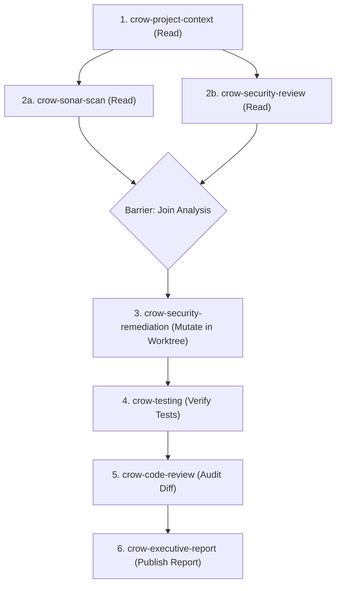
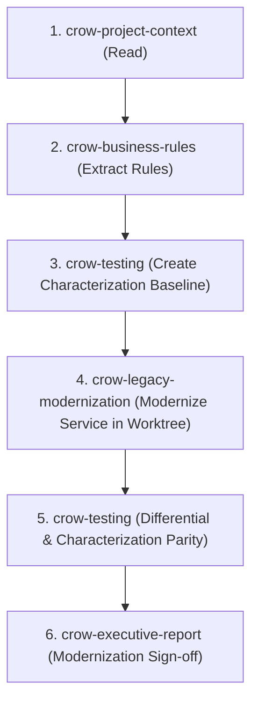
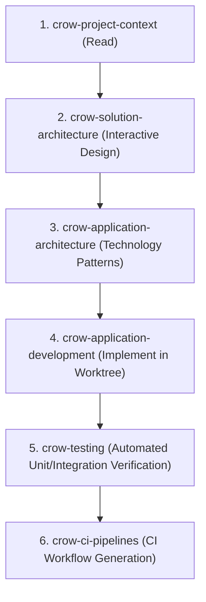

# Crow Asset Catalog and Routing Matrix

This reference provides the workflow coordinator with a comprehensive mapping of Crow's 21 skills and 16 agents, their execution properties, inputs, outputs, and canonical sequences.

## Asset Classification Matrix

| Asset Name | Type | Nature | Primary Role | Standard Inputs | Emitted Outputs |
|---|---|---|---|---|---|
| `crow-project-context` | Skill | Read-only | Discovery of repository stack, tools, and `crow.config` memory. | Repository root. | Technology summary, project memory. |
| `crow-solution-architecture` | Skill / Agent | Read-only | B.C.-aligned solution architecture design and domain interviews. | Project context, stakeholder brief. | Solution architecture markdown and HTML report. |
| `crow-architecture-review` | Skill / Agent | Read-only | Evidence-based architectural classification and inspection. | Repository codebase. | Architecture assessment report. |
| `crow-application-architecture` | Skill | Read-only | Architectural design patterns (.NET, Java, PHP). | Architecture brief. | Architectural pattern recommendations. |
| `crow-application-development` | Skill | Mutation | Implementation and evolution of application features. | Design spec, tests. | Code modifications in worktree. |
| `crow-sonar-scan` | Skill | Read-only | SonarQube / SonarCloud static analysis scanning. | Project sources, sonar-project.properties. | Static quality findings. |
| `crow-security-review` | Skill / Agent | Read-only | 17-module forensic security, authorization, and data-flow audit. | Source code, dependencies. | Security findings markdown & SARIF. |
| `crow-security-remediation` | Agent | Mutation | Automated remediation of verified security vulnerabilities. | SARIF report, security findings. | Verified code patches, Pester tests. |
| `crow-code-review` | Skill / Agent | Read-only | Diffs, pull requests, and self-review quality inspection. | Git diff. | Code review findings & recommendations. |
| `crow-business-rules` | Skill / Agent | Read-only | Code-first business rule extraction and HTML reporting. | Source files, database schemas. | Business rules report with Mermaid flows. |
| `crow-legacy-modernization` | Skill / Agent | Hybrid | Multi-phase legacy replacement and baseline characterization. | Legacy source, contracts. | Modernized service code & tests. |
| `crow-testing` | Skill / Agent | Mutation | Feature scenarios, unit/integration tests, and characterization. | Source code, API contracts. | Pester, JUnit, xUnit test suites. |
| `crow-ci-pipelines` | Skill / Agent | Mutation | GitHub Actions, Azure Pipelines, and Jenkins CI authoring. | Project structure, test commands. | CI workflow YAML / Jenkinsfiles. |
| `crow-bcgov-ux` | Skill / Agent | Mutation | Accessible B.C. Design System and WCAG 2.2 AA review/fix. | Frontend templates (HTML, React, Razor). | Accessible UI code. |
| `crow-framework-updates` | Skill / Agent | Mutation | Language runtime and SDK upgrades (e.g. .NET 8, Java 21). | Dependency files (`pom.xml`, `.csproj`). | Updated project files & migration notes. |
| `crow-dependency-updates` | Skill / Agent | Mutation | Routine package and library upgrades. | Package lockfiles. | Updated dependencies & changelog. |
| `crow-simplification-review` | Skill / Agent | Read-only | Review for unnecessary complexity and tracked Crow debt. | Codebase diff. | Simplification report. |
| `crow-executive-report` | Skill / Agent | Read-only | Executive summary dashboard rendering. | Synthesized findings, metrics. | HTML executive dashboard report. |
| `crow-raven-setup` | Skill / Agent | Mutation | Raven MCP server and codebase-memory setup. | Client configuration. | Installed MCP server registrations. |
| `crow-agent-skill-authoring` | Skill / Agent | Mutation | Authoring Crow agents, skills, and validation scripts. | Asset templates. | New Crow skill/agent files. |
| `crow-agent-skill-review` | Skill / Agent | Read-only | Quality and release audit of Crow assets. | Asset files. | Quality evaluation report. |
| `crow-release` | Skill | Mutation | Version bumping, changelog creation, and APM packaging. | Release candidate files. | Distribution zip archive, git tag. |

## Canonical Orchestration Sequences

### 1. Security Review & Remediation Workflow

### 2. Legacy Modernization Workflow

### 3. Application Architecture & Implementation

