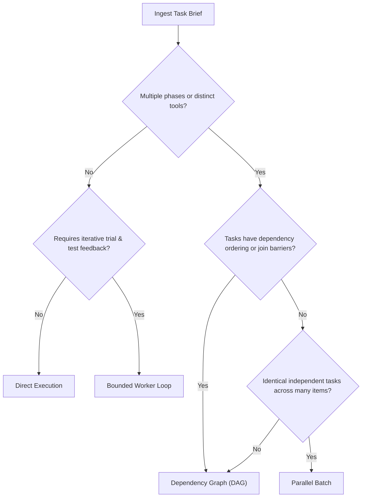

# Crow Strategy Selection Guide

The workflow coordinator selects an execution pattern before any agent or skill work begins. This document defines the deterministic criteria used to choose between Direct Execution, Dependency Graph (DAG), Bounded Loop, and Parallel Batch.

## Strategy Taxonomy

| Strategy | When to Select | Plan Artifact | Execution Vehicle |
|---|---|---|---|
| **Direct** | Localized single-file or single-component changes with clear, known solutions and low risk. | Implementation notes | Current session thread |
| **Graph (DAG)** | Multi-phase workflows with prerequisite dependencies, parallel analysis fan-out, join barriers, or ordered mutations. | `graph-manifest.json` | `Invoke-CrowGraphRunner.ps1` in isolated worktree |
| **Bounded Loop** | Single bounded task requiring iterative test-fix cycles with a locked verifier. | Task packet (`handoffs/task_<id>.md`) | Inner worker agent with supervisor verification |
| **Parallel Batch** | Many similarly shaped, completely independent tasks partitioned across files or services. | Batch job list | Parallel worker dispatch |

## Diagnostic Selection Matrix

## Selection Criteria

### 1. Direct Execution
- **Triggers:** The requested change is confined to 1–2 files, does not require multi-agent review, has no prerequisite dependencies, and does not alter architecture.
- **Example:** Fixing a typo in a documentation template, updating a single configuration setting in `crow.config`.

### 2. Dependency Graph (DAG)
- **Triggers:** The task involves multiple distinct phases where outputs from earlier steps feed into later steps (e.g., project discovery preceding architecture review; security scans preceding automated remediation; test generation following legacy rule extraction).
- **Invariants:** Must have a clear directed topology. Independent read phases execute in parallel. Mutations run in an isolated worktree.

### 3. Bounded Worker Loop
- **Triggers:** A single bounded objective requires exploratory coding and iterative test execution until a test suite passes.
- **Invariants:** The inner worker loop is strictly prohibited from running `git commit`, `git push`, or modifying branch pointers. Only the outer supervisor commits upon verification. Maximum iteration limit (typically 3–5 cycles) prevents infinite loops.

### 4. Parallel Batch
- **Triggers:** A uniform operation must be applied across multiple independent services, repositories, or packages with zero cross-item dependencies.
- **Invariants:** Each item runs independently. Failures on one item do not block processing of others.
